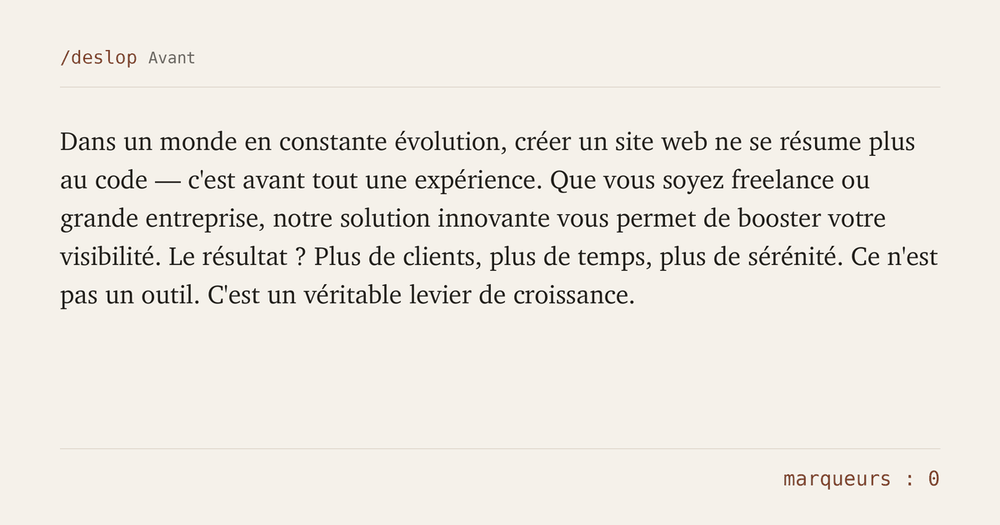

# No Slop Kit pour Claude Code

Des règles globales et cinq skills pour Claude Code. Avec eux, Claude écrit moins de code, n'invente rien, consomme moins de tokens et arrête de produire les textes et les designs qui font dire « ça, c'est une IA ».

   

[English version](README.md)



## Pourquoi ce kit

Je crée des sites avec l'IA tous les jours. Elle me fait gagner des heures. Elle me ressortait aussi toujours les mêmes choses : des tirets cadratins partout, des « ce n'est pas X, c'est Y », des dégradés violets, trois cartes avec une icône au-dessus, de faux témoignages, un paquet qui n'existe pas, 400 lignes réécrites pour corriger une ligne.

Je suis contre le slop pour une raison simple. L'IA devrait nous rendre du temps pour les idées et la création. Le slop fait l'inverse : il nous laisse arrêter de réfléchir, et tous les sites, tous les textes finissent par se ressembler.

J'ai donc noté chaque règle que je répétais à Claude et j'en ai fait un kit que tout le monde peut installer en quelques minutes. Il est gratuit et ouvert. J'accepte toutes les propositions : ouvre une issue, ou envoie directement une pull request.

## La preuve par l'exemple

Voici ce que fait `/deslop` sur un paragraphe typique écrit par une IA. L'animation en haut de page rejoue cet exemple à partir du rapport du skill.

**Avant**

> Dans un monde en constante évolution, créer un site web ne se résume plus au code — c'est avant tout une expérience. Que vous soyez freelance ou grande entreprise, notre solution innovante vous permet de booster votre visibilité. Le résultat ? Plus de clients, plus de temps, plus de sérénité. Ce n'est pas un outil. C'est un véritable levier de croissance.

**Après**

> Un site web doit aussi être agréable à utiliser. Notre solution aide les freelances comme les grandes entreprises à se faire connaître. Vous gagnez des clients et du temps. Votre activité grandit, et vous travaillez plus sereinement.

**Ce que le skill a retiré**

| Avant | Après | Pourquoi |
|---|---|---|
| « Dans un monde en constante évolution » | supprimé | Généralité qui irait dans n'importe quel texte |
| « — » | phrase reconstruite | Tiret cadratin, toujours retiré |
| « ne se résume plus au code, c'est avant tout une expérience » | « doit aussi être agréable à utiliser » | Construction « ce n'est pas X, c'est Y » |
| « Que vous soyez freelance ou grande entreprise » | « les freelances comme les grandes entreprises » | Ouverture toute faite |
| « innovante », « booster », « véritable », « levier » | retirés | Vocabulaire banni et intensif creux |
| « Le résultat ? » | supprimé | Question rhétorique suivie de sa réponse |
| « Plus de clients, plus de temps, plus de sérénité. » | une phrase avec deux verbes | Groupe de trois par réflexe |
| « Ce n'est pas un outil. C'est un véritable levier de croissance. » | « Votre activité grandit » | Même construction. L'idée de croissance est gardée, la formule part |

Marqueurs : 11 avant, 0 après.

Toutes les idées de départ sont encore là. Le skill change la forme, garde les exemples de l'auteur et signale ce qu'il ne peut pas vérifier. Il n'invente jamais un chiffre pour muscler une phrase.

Ce README est passé par le même skill avant publication.

## Ce qu'il contient

| Fichier | Rôle | Chargé quand |
|---|---|---|
| `CLAUDE.md` | Règles globales : ne rien inventer, dev paresseux, économie de tokens, socle de sécurité, style d'écriture | À chaque session |
| `settings.json` | Bloque la lecture des `.env`, des lockfiles et des dossiers de build, et quelques commandes destructrices | À chaque session |
| `skills/deslop` | Réécrit un texte pour retirer ce qui sonne IA, avec un catalogue français et un anglais, et montre ce qui a été retiré | Sur les textes à publier, ou `/deslop` |
| `skills/ui-design` | Fautes qui tuent la confiance, dark patterns, réflexes de design par défaut, typo, couleur, tokens, composants, checklist de lancement | Sur tout travail d'interface, ou `/ui-design` |
| `skills/security` | 19 sections, des secrets aux webhooks et aux paiements, plus un audit avant mise en ligne avec des commandes concrètes | Sur l'auth, les données, les API, les paiements, ou `/security` |
| `skills/reliability` | Limites de requêtes, plafonds d'API, délais d'attente, états vides et d'erreur, index, cache, surveillance, sauvegardes restaurables | Sur les données, les API et le déploiement |
| `skills/project-setup` | Écrit le `CLAUDE.md` d'un projet à partir des fichiers du dépôt, sans rien inventer | Seulement avec `/project-setup` |

## Ce que ça change

### Le code

Claude vérifie la version installée d'une bibliothèque avant d'utiliser son API, et vérifie qu'un paquet existe avant de l'installer : un nom halluciné peut correspondre à un paquet malveillant. Il cite `fichier:ligne` quand il parle de ton code. Avant d'écrire, il descend une échelle : supprimer, réutiliser, fonction native de la plateforme, bibliothèque standard, dépendance déjà installée. Le nouveau code arrive en dernier. Le diff reste le plus petit possible, sans refactorisation bonus, et Claude n'affirme jamais avoir testé ce qu'il n'a pas lancé.

« Paresseux » veut dire ici paresseux sur le code : moins Claude écrit, moins tu as à relire. Jamais paresseux sur la réflexion.

### Les tokens

Claude cherche avant de lire, ignore les lockfiles et les dossiers de build, lance un seul fichier de test pendant qu'il itère et la suite complète une fois, et termine une tâche en trois lignes. Le `CLAUDE.md` principal reste sous les 200 lignes recommandées par Anthropic. Un skill ne coûte que sa description tant qu'une tâche n'en a pas besoin.

### Le design

Avant de coder, Claude rédige un court brief avec une référence réelle et propose deux directions. Il écarte son premier réflexe de police et de couleur, parce que ce réflexe est le même sur tous les projets. Avant de montrer une page, il passe en revue chaque motif par défaut qu'il a utilisé : « choisi, parce que... », ou retiré.

### Les textes

Pas de tiret cadratin, pas de « ce n'est pas X, c'est Y », pas de « plongeons », pas de question rhétorique suivie de sa réponse. La liste complète est dans les catalogues de deslop.

### Sécurité et fiabilité

Vérifications côté serveur sur chaque route, sécurité au niveau des lignes sur chaque table, prix calculés sur le serveur, commandes validées sur un webhook vérifié, délai d'attente sur chaque appel externe, et des sauvegardes que quelqu'un a déjà restaurées.

## Installer

### Laisser Claude Code s'en charger

```bash
git clone https://github.com/withmre/no-slop-kit.git
cd no-slop-kit
claude
```

Puis tape :

```
Lis INSTALL.md et installe ce kit.
```

Claude sauvegarde ta configuration actuelle, demande avant de remplacer quoi que ce soit, fusionne ton `settings.json` au lieu de l'écraser, puis vérifie le résultat.

### À la main (macOS, Linux, WSL)

```bash
mkdir -p ~/.claude/skills
cp -r claude-home/skills/* ~/.claude/skills/
cp -n claude-home/CLAUDE.md ~/.claude/CLAUDE.md
cp -n claude-home/settings.json ~/.claude/settings.json
```

`cp -n` ne touche pas à ton `CLAUDE.md` ni à ton `settings.json` s'ils existent déjà : fusionne-les à la main. La copie des skills écrase ceux qui portent le même nom.

Ouvre une nouvelle session, tape `/` pour voir les skills, et lance `/context` pour vérifier que les règles sont chargées.

## Utiliser

La plupart du temps, tu n'as rien à faire : Claude charge chaque skill quand la tâche le demande. Tu peux aussi les appeler toi-même :

- `/deslop` suivi de ton texte, ou du chemin d'un fichier ;
- `/ui-design` avant de commencer une page ou une refonte ;
- `/security` pour un audit avant mise en ligne ;
- `/project-setup` une fois dans chaque nouveau dépôt.

## L'adapter

Claude répond en français par défaut. Pour changer, modifie la ligne « Always reply in French » dans `CLAUDE.md`. La section 8 du même fichier contient les règles d'écriture en français.

Les mots bannis sont dans `skills/deslop/fr.md` et `skills/deslop/en.md`. Ajoute les tiens.

Chaque ligne de `CLAUDE.md` coûte des tokens à chaque session : retire ce qui ne te sert pas.

Les consignes sont écrites en anglais parce que le même texte y prend moins de tokens. Tout ce qui touche au français (mots bannis, tournures, typographie, mentions légales) reste en français.

## Les habitudes qui économisent le plus

- `/clear` entre deux tâches sans rapport ;
- `/compact` avec une consigne quand une session s'allonge : `/compact garde les décisions sur le schéma` ;
- le mode plan (`Shift+Tab`) pour une grosse tâche, et `Échap` dès que Claude part dans la mauvaise direction ;
- `/mcp` pour couper les serveurs inutiles ;
- des demandes précises, avec le nom du fichier.

## Contribuer

J'accepte toutes les propositions, et les pull requests sont bienvenues sans demander avant. L'objectif est d'aider le plus de monde possible à bien utiliser l'IA.

Ce qui aiderait le plus :

- un catalogue deslop dans ta langue : espagnol, allemand, portugais, italien ;
- les tics d'IA que tu croises et que les catalogues ratent ;
- les réflexes de design des dernières galeries de composants ;
- des vérifications de sécurité ou de fiabilité pour une stack pas encore couverte ;
- les faux positifs : une règle qui a rendu Claude moins bon. Ils comptent autant que les nouvelles règles.

Le détail est dans [CONTRIBUTING.md](CONTRIBUTING.md).

Si le kit t'a évité une réécriture, une étoile aide d'autres personnes à le trouver.

## Évolution des étoiles

[](https://star-history.com/#withmre/no-slop-kit&Date)

## Licence

[MIT](LICENSE). Utilise-le, forke-le, modifie-le.
