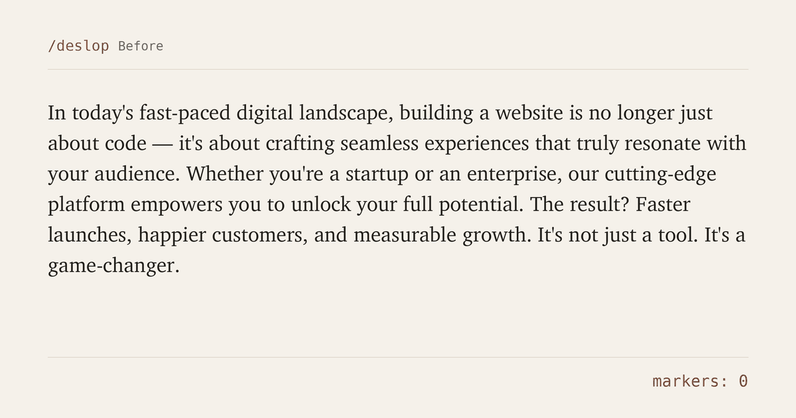
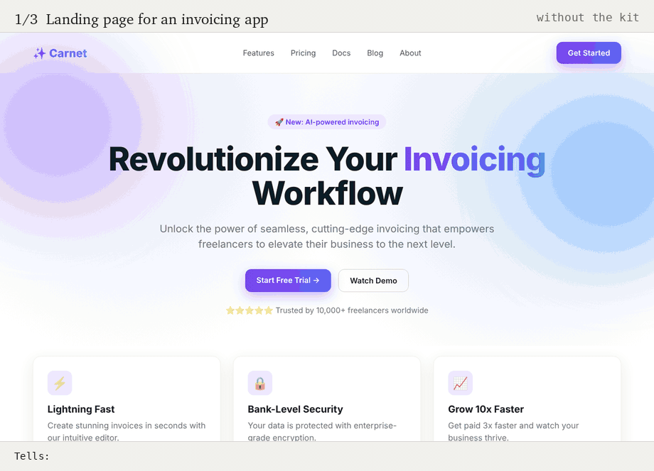

# No Slop Kit for Claude Code

Global rules and seven skills for Claude Code. With them, Claude writes less code, invents nothing, spends fewer tokens, and stops producing the text and design that make people think "an AI made this".

   

[Version française](README.fr.md)



## Why I made this

I build websites with AI every day, and it saves me hours. It also kept handing me the same things: em dashes everywhere, "it's not X, it's Y", purple gradients, three feature cards with an icon on top, fake testimonials, a package that doesn't exist, a 400-line rewrite for a one-line fix.

I'm against slop for one reason. AI should give us time back to spend on ideas and creative work. Slop does the opposite: it lets us stop thinking, and every site and every paragraph starts to look like the next one.

So I wrote down every rule I kept repeating to Claude and turned them into a kit anyone can install in a few minutes. It's free and open. I'll take any suggestion: open an issue, or send a pull request directly.

## See it work

Here is what `/deslop` does to a typical AI-written paragraph. The animation at the top replays this example from the skill's report.

**Before**

> In today's fast-paced digital landscape, building a website is no longer just about code — it's about crafting seamless experiences that truly resonate with your audience. Whether you're a startup or an enterprise, our cutting-edge platform empowers you to unlock your full potential. The result? Faster launches, happier customers, and measurable growth. It's not just a tool. It's a game-changer.

**After**

> Building a website also means making it pleasant for the people who use it. Our platform helps startups and large companies launch sooner, keep their customers happier and grow in a way they can measure.

**The skill's report: "What I removed"**

| Before | After | Why |
|---|---|---|
| "In today's fast-paced digital landscape" | cut | Generic opener that fits any text, and "landscape" is banned |
| "—" | sentence rebuilt | Em dash, always removed |
| "no longer just about code, it's about", "It's not just a tool. It's a game-changer." | "also means", and the second one cut | "It's not X, it's Y", twice. The second adds no idea |
| "seamless", "truly", "resonate", "cutting-edge", "empowers", "unlock your full potential", "game-changer" | removed | Banned vocabulary and empty intensifiers |
| "Whether you're a startup or an enterprise" | "startups and large companies" | Stock opener |
| "The result?" | cut | Question answered right away |
| "Faster launches, happier customers, and measurable growth." | the three results kept, inside one sentence | Verbless group of three used as a punchline |

Left as is and flagged for the author: the growth claim comes with no figure. Add a real one or drop it.

Markers: 14 before, 0 after.

Every idea of the original survived. The skill changes the form, keeps the author's examples, and flags claims it can't check. It never invents a number to make a sentence stronger.

This README went through the same skill before publication.

## Same brief, with and without the kit



Three basic briefs: a landing page for an invoicing app, a neighborhood bakery, a designer's portfolio. Each one is shown twice. The first version reproduces the defaults the `ui-design` skill targets, the ones you get when nothing steers the model: purple gradients, centered heroes, emoji icons, invented numbers. The second follows the skill, starting from a brief with a real-world reference: the carbon-copy receipt book for the invoicing app, the painted shopfronts of old Lyon for the bakery, a research notebook annotated in blue pencil for the portfolio. Each gets its own structure, its own palette and its own pair of fonts, and its one animation shows something true about the product: the invoice gets stamped as paid, the oven times show what comes out next, the annotations explain the designer's method.

All six pages are plain HTML in [`assets/src/pages`](assets/src/pages). Open them and compare the code. Fonts are self-hosted under the SIL Open Font License. Brands, people and prices are fictional.

## What's inside

| File | What it does | When it loads |
|---|---|---|
| `CLAUDE.md` | Global rules: never invent, lazy development, token economy, security baseline, writing style | Every session |
| `settings.json` | Stops Claude's file tools from reading `.env` files, lockfiles and build folders, and asks before a few destructive commands | Every session |
| `skills/deslop` | Review mode rewrites a text and shows what it removed and why. Writing mode applies the same rules silently. French and English catalogues | On text meant for publication, or `/deslop` |
| `skills/ui-design` | Brief and page structure, a catalogue of tells, layout, color, type, tokens, mobile floor, components, a scored self-check, an audit mode and a launch checklist | On any UI work, or `/ui-design` |
| `skills/security` | 19 sections from secrets to webhooks and payments, plus a pre-release audit with concrete commands | On auth, data, API or payment work, or `/security` |
| `skills/reliability` | Rate limits, API cost caps, timeouts, empty and error states, indexes, caching, monitoring, backups that restore | On data, API and deployment work |
| `skills/container-security` | Runtime and image checks for Docker, Compose and Kubernetes, including ports, secrets, privileges and resource limits | On container or deployment work |
| `skills/production-readiness` | Routes a release audit across the relevant skills, with threat modeling, capacity checks and a shared P0/P1/P2 report | Before a public release, high-traffic event or `/production-readiness` |
| `skills/project-setup` | Writes a project's `CLAUDE.md` from the files in the repository, with nothing invented | Only with `/project-setup` |

## What changes in practice

### Code

Claude checks the installed version of a library before using its API, and checks that a package exists before installing it, since a hallucinated package name can belong to a malicious package. It cites `file:line` when it talks about your code. Before writing anything it walks down a ladder: delete, reuse, native platform feature, standard library, installed dependency. New code comes last. The diff stays as small as possible, with no bonus refactor, and Claude never claims it tested something it didn't run.

"Lazy" in this kit means lazy about code: the less Claude writes, the less you have to review. The thinking stays with you.

### Tokens

Claude searches before reading, skips lockfiles and build output, runs one test file while iterating and the full suite once, and ends a task in three lines. The main `CLAUDE.md` stays under the 200 lines Anthropic recommends. Each skill costs only its description until a task needs it.

### Design

For a new site or a redesign, Claude writes a short brief with a real-world reference before any code, and proposes two directions when nothing is set. It picks a page structure for the content (a letter, an index, the product shown first) instead of the hero, three features, call to action rhythm. It drops its own first instinct for fonts and colors, because that instinct is the same on every project, and saves the decisions in a `DESIGN.md` so later pages stay consistent.

Before showing a page, it scores itself on intent, hierarchy, execution, specificity, restraint and variety, and revises anything under 3. Then it lists every default pattern still on the page and marks each one "chosen, because..." or removes it. `/ui-design audit` runs the same checks on an existing site and returns a ranked list without touching the code.

### Text

No em dashes, no "it's not X, it's Y", no "delve", no rhetorical question answered in the next sentence. The full list lives in the deslop catalogues.

### Security and reliability

Server-side checks on every route, row-level security on every table, prices computed on the server, orders fulfilled on a verified webhook, timeouts on every outbound call, containers with explicit runtime boundaries, and backups that get a real restore test. Before a public release or high-traffic event, `/production-readiness` brings those checks together and reports P0, P1 and P2 findings in one format.

## Install

### Let Claude Code do it

```bash
git clone https://github.com/withmre/no-slop-kit.git
cd no-slop-kit
claude
```

Then type:

```
Read INSTALL.md and install this kit.
```

Claude backs up your current configuration, asks before replacing anything, merges your `settings.json` instead of overwriting it, and checks the result.

### By hand (macOS, Linux, WSL)

```bash
mkdir -p ~/.claude/skills
cp -r claude-home/skills/* ~/.claude/skills/
[ -e ~/.claude/CLAUDE.md ] || cp claude-home/CLAUDE.md ~/.claude/
[ -e ~/.claude/settings.json ] || cp claude-home/settings.json ~/.claude/
```

The last two lines copy `CLAUDE.md` and `settings.json` only if you don't have them yet. If you do, merge them by hand. The skills copy overwrites skills with the same names.

Open a new session, type `/` to see the skills, and run `/context` to check the rules are loaded.

## Use it

Most of the time you do nothing. Claude loads each skill when the task calls for it. You can also call them directly:

- `/deslop` followed by your text, or a path to a file.
- `/ui-design` before starting a page or a redesign, `/ui-design audit` on an existing site.
- `/security` for an audit before a release, `/reliability` to check limits, errors and backups.
- `/container-security` for Docker, Compose or Kubernetes work, `/production-readiness` before a public release or high-traffic event.
- `/project-setup` once in each new repository.

## Make it yours

Claude replies in English by default. The kit is shared publicly and its instructions are written in English, so English is the default that works for the most people and costs the fewest tokens. To change it, edit the line "Reply in English by default" in `CLAUDE.md`, for example to "Always reply in French." Section 8 of the same file holds the writing rules, with French and English examples, and the deslop skill ships a catalogue for each language.

Banned words live in `skills/deslop/fr.md` and `skills/deslop/en.md`. Add yours.

Every line of `CLAUDE.md` costs tokens in every session, so remove what you don't use.

## Habits that save the most tokens

- `/clear` between unrelated tasks.
- `/compact` with an instruction when a session grows: `/compact keep the decisions about the schema`.
- Plan mode (`Shift+Tab`) for a big task, and `Esc` as soon as Claude heads the wrong way.
- `/mcp` to turn off servers you don't use.
- Precise requests that name the file.

## Contributing

I accept every proposal worth discussing, and pull requests are welcome without asking first. The goal is to help as many people as possible use AI well.

What would help most:

- A deslop catalogue for your language: Spanish, German, Portuguese, Italian.
- AI tells you keep seeing that the catalogues miss.
- Design reflexes from the latest component galleries.
- Security, reliability or container checks for a stack the skills don't cover yet.
- False positives: a rule that made Claude worse. These matter as much as new rules.

Details in [CONTRIBUTING.md](CONTRIBUTING.md).

If the kit saved you a rewrite, a star helps other people find it.

## Thanks

Two open-source skills sharpened this kit: [Hallmark](https://github.com/nutlope/hallmark), for the idea of structural variety, the scored self-check and many precise design tells, and [anti-ai-slop-writing](https://github.com/jalaalrd/founder-toolkit), for the rules on parataxis, the hedging seesaw and writing without inventing. Their ideas are rewritten here in this kit's own words and adapted to its rules. Both are MIT-licensed and worth a look.

## Star history

[](https://star-history.com/#withmre/no-slop-kit&Date)

## License

[MIT](LICENSE). Use it and change it as you like.
